# Proof of Geography (PoG)

**Cryptographic, speed-of-light physical location proofs for GPUs, confidential datacenters, and AI inference endpoints—secured by hardware TEEs and a 24-node multi-cloud Anchor network.**

---

## Why This Matters Right Now

Today, knowing *where* a server or GPU physically sits is built almost entirely on **honor-system paperwork**—cloud region labels, WHOIS entries, ISP geofeeds, and marketing claims. That breaks down across three urgent real-world problems:

1. **Localizing GPUs & National Security / Compute Governance:**
   Governments, hardware vendors, and AI labs increasingly need verifiable assurance of *where* restricted, frontier-class GPUs (H100/B200 clusters) are physically operating—without relying on easily spoofed IP addresses, GPS feeds, or self-reported datacenter claims.
2. **Data Sovereignty & Regulatory Compliance:**
   Enterprises processing healthcare, financial, defense, or GDPR-regulated data must prove workloads execute inside authorized jurisdictions—not merely that a front-end load balancer sits there.
3. **Exposing Inference Cloud & Router Lies:**
   A growing wave of AI inference clouds and multi-provider routers claim US or EU hosting while silently forwarding prompts to cheaper, unapproved, or offshore GPU clusters behind a local reverse proxy. Traditional IP geolocation (even active-probing networks like IPinfo ProbeNet) only locates the *front-end IP endpoint*—a \$5/mo proxy in Singapore or Frankfurt answers ICMP/TCP pings in 1 ms while forwarding the actual LLM inference 4,500 km away.

**Proof of Geography closes this gap with physics and silicon.** By placing a non-exportable signing key inside the Prover's hardware **Trusted Execution Environment** (AMD SEV-SNP, Intel TDX, AWS Nitro Enclaves, optionally bound via SPDM to Confidential GPUs) and having **independent surrounding multi-cloud Anchor TEEs** time unpredictable microsecond UDP challenge-response bursts, a front-end proxy *cannot* answer on the enclave's behalf. Physics forces every challenge packet all the way to the actual CPU/GPU silicon and back, turning round-trip latency into an unforgeable speed-of-light distance disk.

---

## How It Works

```mermaid
flowchart LR
    subgraph Prover["Target Datacenter / GPU Cluster (Untrusted Host)"]
        TEE["Prover TEE (SEV-SNP / TDX / Nitro + Optional H100/B200 SPDM)<br/>Unified Workload + Non-Exportable Key sk_P + UDP Responder"]
    end

    subgraph Anchors["24-Node Multi-Cloud Anchor Grid (6 Independent Clouds)"]
        GCP["GCP (SEV-SNP Genoa + TDX)"]
        AWS["AWS (SEV-SNP c6a + Nitro)"]
        AZ["Azure (DCas/DCes CVM)"]
        OVH["OVHcloud (EU Sovereign)"]
        BD["ByteDance / BytePlus (Asia)"]
        TC["Tencent Cloud (HK / Asia)"]
    end

    subgraph Verify["Zero-Gas Consumption (DNS / CT Model)"]
        HDR["Handshake-Attached<br/>X-PoG-Proof / RA-TLS Header"]
        LOG["Continuous Hourly Chain<br/>Signed Merkle Transparency Log"]
    end

    TEE <== "Phase 2: 8x 64-byte UDP BLAKE3-MAC Burst<br/>Timed by Anchor Kernel SO_TIMESTAMPNS" ==> GCP
    TEE <== "Deterministic Multi-Cloud Committee (K=6, f=1)" ==> AWS
    TEE <== "Orthogonal Framing (N/S/E/W + Metro)" ==> AZ
    TEE <== "No Single Cloud / Country Controls Quorum" ==> OVH
    TEE <== "All-Pairs Anchor Calibration Mesh" ==> BD
    TEE <== "Signed Ed25519 AnchorReceipts" ==> TC

    TEE --> HDR
    TEE --> LOG
```



### Core Design Pillars

* **Split Stopwatch from Identity:** The Prover TEE *never* times its own RTT (defending against host hypervisor clock skew/VM freezing). Independent multi-cloud Anchor TEEs hold the stopwatch using Linux `SO_TIMESTAMPNS` + `SO_BUSY_POLL` (and AMD Secure TSC), while the Prover TEE provides an unforgeable, migration-disabled (`MIGRATE_MA=0`) hardware-bound cryptographic reply.
* **Two-Tier Physics Bounds + Starlink Defense:** Every proof publishes all three tiers simultaneously:
  * **Tier 1A — Vacuum Speed of Light (`c_0 = 299,792.458 km/s`, ~93.1 mi/ms RTT):** Strictly uncheatable even against private hollow-core fiber, line-of-sight microwave, or **Starlink LEO vacuum optical inter-satellite links (ISLs)**. *(Our simulation proves Starlink vacuum lasers can beat ideal silica fiber past ~4,283 km, which is why Tier 1A vacuum is the gold-standard adversarial bound.)*
  * **Tier 1B — Silica Optical Fiber (`c_fiber = 204,000 km/s`, ~63.4 mi/ms RTT):** Tighter terrestrial/subsea fiber bound (including cloud private backbones).
  * **Tier 2 — IPinfo-Style Calibrated Empirical Radius:** Learned live from the all-pairs Anchor calibration mesh and fused with RFC 8805 geofeed validation & traceroute rDNS airport-code hints to catch `LastHopProxyJump` router lies.
* **Exact $O(K^3)$ Byzantine $(K-f)$-Core Geometry on $\mathbb{S}^2$:** Upper-bound disks (never thin rings, so artificial delay only *weakens* a proof) are intersected as 3D spherical half-spaces. Even if up to $f$ Anchors collude and fabricate `0.3 ms` RTTs, verifying all at most $K^2 + 1 = 37$ boundary extrema mathematically proves 100% of the feasible region lies inside the geofence.
* **Continuous Hourly Chains + Handshake Proofs (Anti-Boat / Anti-Plane / Mobile DC):** Never attest once—hardware can be attested in port and moved onto a ship, truck, or aircraft. Provers attach fresh `X-PoG-Proof` bundles to connection handshakes **and** append continuous hourly hash-chained proofs to a DNS / Certificate Transparency–style signed Merkle log (`pog-log`). Stationary datacenters tighten their proven radius by **>50%** over 24h via orthogonal minimum-RTT convergence, while any physical relocation triggers an immediate `PhysicalRelocationDetected` alert.
* **Runs Free Like DNS (Blockchain Tabled):** No tokens, wallets, or per-proof gas fees are required. The 24-node grid runs as an ultra-cheap public utility (~$1,100–$2,000/mo total), with optional Merkle-root anchoring documented in [docs/BLOCKCHAIN_EXTENSION.md](docs/BLOCKCHAIN_EXTENSION.md).

---

## How Many Trillions of Requests Can a 24-Node Grid Handle?

Empirical release-build benchmarks (`cargo run --release --bin pog-cli -- bench`) + full breakdown in [docs/CAPACITY_AND_ECONOMICS.md](docs/CAPACITY_AND_ECONOMICS.md):

* **Prover Timed Fast-Path (`BLAKE3-MAC`):** **72.7 ns/op** (**13.76M ops/sec/core**) — adds `< 0.0001 ms` (`< 15 meters`) to the speed-of-light radius.
* **Client Offline Verification (`verify_proof_bundle` — TEE quote + 6 Ed25519 sigs + exact $O(K^3)$ Byzantine core):** **131.5 µs/verify** (**7,606 verifies/sec/core**).
* **Raw Live UDP Proofs (24 Anchors, 1 pinned NIC core/node @ 120k pkt/s, $M=8$ rounds, $K=6$ Anchors/proof):**
  * **~60,000 raw live proofs/sec** = **~1.89 TRILLION raw live proofs / year** (at < \$2,000/mo infra cost).
* **Handshake-Attached / Hourly-Cached Client Requests (DNS-style):**
  * Once a datacenter/GPU cluster refreshes its signed proof hourly (or every 5 minutes), it attaches the compact `X-PoG-Proof` header to **every** incoming TLS/API/inference connection with **zero traffic to the Anchor grid**.
  * **10,000,000 distinct servers globally** running continuous hourly chains consume only **~2,778 proofs/sec (< 5% of our 24-node grid!)**, while authenticating **tens of trillions to quadrillions of client requests per year**.

---

## Live Red-Team & Physics Simulation Results

Run locally via `cargo run --release --bin pog-cli -- simulate`:

| Scenario | Result | Key Measurement |
| :--- | :--- | :--- |
| **1. Honest Tokyo H100 GPU Cluster** *(4 clouds, $f=1$ Byzantine quorum)* | **PASS** | Tier 1A Vacuum: **161.7 km (100.5 mi)** · Tier 1B Fiber: **111.3 km (69.2 mi)** · Tier 2 Calibrated: **90.8 km (56.4 mi)** |
| **2. Inference Router Lie** *(Beijing GPUs proxying via Singapore)* | **CAUGHT** | Front-end IP responds in `1.4 ms` in Singapore, but TEE RTT = `62.0 ms` -> worst-case distance **6,828 km** + 3 IPinfo proxy/geofeed alerts |
| **3. Starlink LEO Laser Relay Audit** *(550 km shell, 40° elev)* | **AUDITED** | Beats ideal fiber past **4,283 km**, failing Tier 1B at 5,000–9,000 km; **Tier 1A Vacuum remains 100% SAFE at all distances** |
| **4. Byzantine Colluding Anchor** *(1 of 6 fabricates `0.3 ms` RTT)* | **BLOCKED** | 5-of-6 Byzantine core rejects Singapore spoof (max distance **6,713 km**) |
| **5. Mobile Datacenter / Relocation** *(Ashburn -> Frankfurt in 8h)* | **CAUGHT** | Disjoint feasible regions trigger `PhysicalRelocationDetected` (**6,544 km**, implied speed **818 km/h**) |
| **6. 24-Hour Stationary Convergence** *(Chicago — no local anchor!)* | **CONVERGED** | 4-direction orthogonal hourly chain cuts Tier 1B radius from `1,785 km` -> **835 km (53.2% tighter)** |

---

## Global 24-Node Multi-Cloud Anchor Grid

Defined in [config/global_grid_24.json](config/global_grid_24.json) and provisioned via [infra/terraform/](infra/terraform/):

| Cloud Provider | Nodes | Regions | Hardware TEE Stack |
| :--- | :---: | :--- | :--- |
| **Google Cloud (GCP)** | 8 | Ashburn, Iowa, Oregon, Frankfurt, London, Tokyo, Taiwan, Singapore | AMD SEV-SNP (`c3d-standard-4`, Secure TSC) & Intel TDX (`c3-standard-4`) |
| **Amazon Web Services (AWS)** | 8 | N. Virginia, Oregon, San Jose, Frankfurt, Stockholm, Tokyo, Seoul, Sydney | EC2 AMD SEV-SNP (`c6a.large`, direct ENA) & Nitro Enclaves (`c6i.xlarge`) |
| **Microsoft Azure** | 4 | Texas, Toronto, Amsterdam, São Paulo | Confidential VM SEV-SNP (`Standard_DC2as_v5`) & Intel TDX (`DC2es_v5`) |
| **OVHcloud (EU Sovereign)** | 2 | Gravelines (FR), Warsaw (PL) | AMD SEV-SNP sovereign EU nodes outside US hyperscalers |
| **ByteDance (BytePlus / Volcengine)** | 1 | Singapore / Johor Edge | Confidential ECS Intel TDX (`ecs.c3t.large`) |
| **Tencent Cloud** | 1 | Hong Kong | Confidential CVM AMD SEV-SNP (`S6.MEDIUM4`) |

---

## Repository Layout

* `crates/pog-geo` — Exact $\mathbb{S}^2$ spherical cap math, Tier 1A/1B/2 + Starlink ISL bounds, $O(K^3)$ Byzantine $(K-f)$-core verifier, all-pairs Anchor calibration matrix, and continuous-chain mobile-datacenter relocation detector.
* `crates/pog-tee` — Hardware TEE providers & policy enforcement (`MIGRATE_MA=0`, `DEBUG=0`, `SecureTSC`, Confidential GPU SPDM binding) for AMD SEV-SNP (`/dev/sev-guest`), Intel TDX (ConfigFS TSM), AWS Nitro Enclaves (`/dev/nsm`), and local dev mode.
* `crates/pog-proto` — Deterministic multi-cloud/multi-quadrant committee selection, fixed 64-byte UDP `BLAKE3-MAC` wire protocol, Linux `SO_TIMESTAMPNS` / `SO_BUSY_POLL` socket fast-path, `X-PoG-Proof` handshake header encoding, and standalone offline verifier.
* `crates/pog-telemetry` — IPinfo-inspired active telemetry fusion (RFC 8805 geofeed parser, traceroute IATA airport-code rDNS extractor, `LastHopProxyJump` detector, 68%/95% confidence radii).
* `crates/pog-log` — DNS / Certificate Transparency–style append-only signed Merkle log (`RFC 6962` inclusion proofs + `SignedTreeHead`) with Axum HTTP API (`/.well-known/pog-registry`, `/v1/attestations`, `/v1/provers/:id/latest`, `/v1/sth`).
* `crates/pog-anchor` — Production multi-cloud Anchor TEE daemon (TCP Phase 1 + pinned UDP Phase 2).
* `crates/pog-prover` — Production Prover TEE sidecar (hourly hash-chain runner + `/v1/handshake-proof` `X-PoG-Proof` header injector).
* `crates/pog-cli` — Verifier, red-team simulator, throughput benchmarker, transparency log runner, and GeoJSON map exporter.
* `infra/terraform` & `infra/images` — Multi-cloud IaC modules across 6 clouds, reproducible measured NixOS TEE VM `flake.nix`, and AWS Nitro `.eif` build pipeline.

---

## Quickstart

```bash
# 1. Run full unit + live local UDP integration test suite
cargo test --workspace

# 2. Run the 6-scenario red-team & physics simulation suite
cargo run --release --bin pog-cli -- simulate

# 3. Run empirical crypto/verifier throughput & capacity benchmarks
cargo run --release --bin pog-cli -- bench --verify-iters 5000

# 4. Export Tokyo Anchor circles & Byzantine (K-f)-core polygon to GeoJSON (view on geojson.io)
cargo run --release --bin pog-cli -- export-geojson --lat 35.6762 --lon 139.6503 --out tokyo.geojson

# 5. Start the DNS/CT-style transparency log server locally
cargo run --release --bin pog-cli -- serve-log --listen 127.0.0.1:8090 --allow-dev-tee
```

---

## Further Reading

* [docs/ARCHITECTURE.md](docs/ARCHITECTURE.md) — Protocol sequence, Starlink ISL crossover physics, and exact $O(K^3)$ Byzantine $(K-f)$-core proof.
* [docs/THREAT_MODEL.md](docs/THREAT_MODEL.md) — 11 adversarial attack vectors (including proxies, split-TEEs, Starlink, mobile boats/aircraft, clock skew, and colluding clouds) and residual risks.
* [docs/CAPACITY_AND_ECONOMICS.md](docs/CAPACITY_AND_ECONOMICS.md) — Detailed trillions-of-requests throughput math and 24-node multi-cloud operating costs.
* [docs/BLOCKCHAIN_EXTENSION.md](docs/BLOCKCHAIN_EXTENSION.md) — Optional future on-chain STH / smart-contract settlement path.
