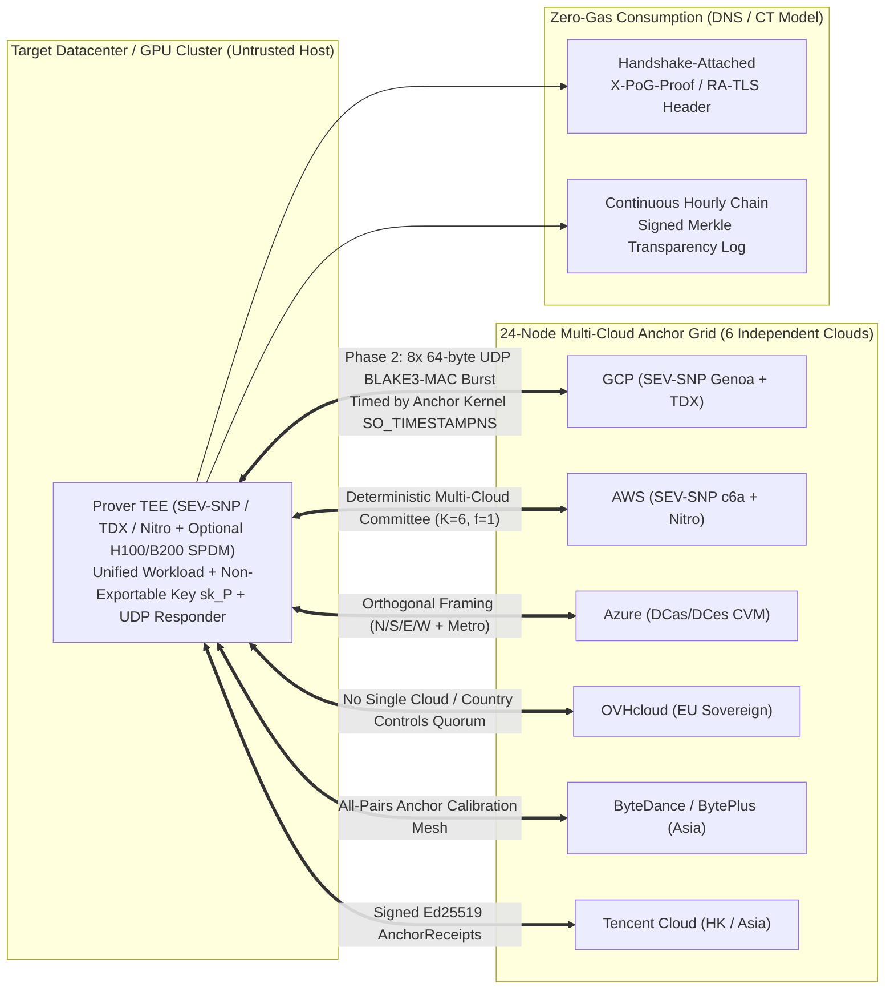

# Proof of Geography (PoG)

**Unspoofable, cryptographic, speed-of-light physical location proofs for GPUs, confidential datacenters, and AI inference endpoints—secured by hardware TEEs and a multi-cloud Anchor network.**

> 🌐 **Try the Live Interactive Speed-of-Light Visualizer:** **[https://proofofgeography.com](https://proofofgeography.com)**
> Watch 9 live multi-cloud Anchors (GCP Intel TDX, GCP AMD SEV-SNP & AWS) locate your browser in real time, simulate spoofing / inference-cloud lies, explore our **72-Node Rim-Surrounded Global Grid** (4-quadrant framing across North America, Canada, Mexico, Caribbean, Europe, Iceland, Faroe Islands, Azores, North Africa & Middle East), and cryptographically verify `X-PoG-Proof` headers online!

---

## Why This Matters Right Now

Today, knowing *where* a server or GPU physically sits is built almost entirely on **honor-system paperwork**—cloud region labels, WHOIS entries, ISP geofeeds, and marketing claims. That breaks down across three urgent real-world problems:

1. **Localizing GPUs & National Security / Compute Governance:**
   Governments, hardware vendors, and AI labs increasingly need verifiable assurance of *where* restricted, frontier-class GPUs (H100/B200 clusters) are physically operating—without relying on easily spoofed IP addresses, GPS feeds, or self-reported datacenter claims.
2. **Data Sovereignty & Regulatory Compliance:**
   Enterprises processing healthcare, financial, defense, or GDPR-regulated data must prove workloads execute inside authorized jurisdictions—not merely that a front-end load balancer sits there.
3. **Exposing Inference Cloud & Router Lies:**
   A growing wave of AI inference clouds and multi-provider routers claim US or EU hosting while silently forwarding prompts to cheaper, unapproved, or offshore GPU clusters behind a local reverse proxy. Traditional IP geolocation (even active-probing networks like IPinfo ProbeNet) only locates the *front-end IP endpoint*—a \$5/mo proxy in Singapore or Frankfurt answers ICMP/TCP pings in 1 ms while forwarding the actual LLM inference 4,500 km away.

**Proof of Geography closes this gap with physics and silicon.** By placing a non-exportable signing key inside the Prover's hardware **Trusted Execution Environment** (AMD SEV-SNP, Intel TDX, AWS Nitro Enclaves, optionally bound via SPDM to Confidential GPUs) and having **independent surrounding multi-cloud Anchor TEEs** time unpredictable microsecond UDP challenge-response bursts, a front-end proxy *cannot* answer on the enclave's behalf. Physics forces every challenge packet all the way to the actual CPU/GPU silicon and back, turning round-trip latency into an unforgeable speed-of-light distance disk.

---

## Live Geolocation Result (Real 9-Node Multi-Cloud Pilot)

Real-time speed-of-light geolocation of a developer laptop behind NAT measured live over the public internet against **9 isolated Anchors** across **GCP (real Intel TDX + real AMD SEV-SNP)** and **AWS** (`9/9` Ed25519 Anchor receipts verified offline identically by the Rust, Python, and TypeScript SDKs):


*Datacenter-to-datacenter cross-cloud pairs tighten even further with zero last-mile ISP overhead: live **GCP Frankfurt (AMD SEV-SNP) <-> AWS Frankfurt** measured **1.54–1.69 ms** (**46–55 mi** calibrated / **144–158 mi** hard vacuum), and **GCP Ashburn (Intel TDX) <-> AWS Ashburn** measured **1.85 ms** (**65.3 mi** calibrated / **174.7 mi** hard vacuum). See the full 9×9 live matrix in [docs/LIVE_PILOT_RESULTS.md](docs/LIVE_PILOT_RESULTS.md).*

### Try It Right Now Against the Live Locked-Down 9-Node Public Grid

1. **In your browser (zero install):** Open **[https://proofofgeography.com](https://proofofgeography.com)** and click **⚡ Locate Me Live** (or **🕵️ Try to Spoof** to test speed-of-light lie detection).
2. **From your terminal (full cryptographic UDP `BLAKE3-MAC` + Ed25519 receipts):**
   ```bash
   git clone https://github.com/jperla/proof-of-geography
   cd proof-of-geography
   cargo run --release --bin pog-cli -- probe-live \
     --grid config/public_anchors.json \
     --rounds 8 --allow-dev-tee
   ```
   *(Public Anchor registry is also served live at `https://proofofgeography.com/.well-known/pog-registry`.)*

### Public Security Lockdown

All 9 live public Anchors and the isolated `proofofgeography.com` web host run in a strictly segregated GCP project + dedicated AWS VPCs with defense-in-depth hardening:
* **Zero Public SSH (`22/tcp` closed everywhere):** All cloud firewalls block port 22; Anchors also close HTTP `80/tcp`.
* **Zero Cloud Credentials / IMDS Attack Surface:** AWS EC2 IMDS is completely disabled (`http_endpoint = "disabled"`); GCP VMs have zero IAM service account scopes + Shielded VM Secure Boot, vTPM, and Integrity Monitoring enabled; host `iptables` + cloud egress firewalls block RFC1918 private ranges and all Anchor outbound TCP (UDP `123` NTP + `1024-65535` PoG replies only).
* **Hardened `pog-anchor` (`v0.1.2`) + Systemd Sandboxing:** Bounded 32 KiB Phase 1 line cap & 4s/12s Slowloris timeouts, mandatory authenticated UDP `PUNCH` (eliminates UDP reflection DDoS), scoped UDP port window (`40000-40999/udp`), concurrency cap (`64`), per-IP (`12/min`) + global (`600/min`) rate limiting, 60-second cached `/info` endpoint, and strict systemd confinement (`ProtectSystem=strict`, `NoNewPrivileges=yes`, `MemoryDenyWriteExecute=yes`, `MemoryMax=256M`).

---

## How It Works



### Core Design Pillars

* **Split Stopwatch from Identity:** The Prover TEE *never* times its own RTT (defending against host hypervisor clock skew/VM freezing). Independent multi-cloud Anchor TEEs hold the stopwatch using Linux `SO_TIMESTAMPNS` + `SO_BUSY_POLL` (and AMD Secure TSC), while the Prover TEE provides an unforgeable, migration-disabled (`MIGRATE_MA=0`) hardware-bound cryptographic reply.
* **Two-Tier Physics Bounds + Starlink Defense:** Every proof publishes all three tiers simultaneously:
  * **Tier 1A — Vacuum Speed of Light (`c_0 = 299,792.458 km/s`, ~93.1 mi/ms RTT):** Strictly uncheatable even against private hollow-core fiber, line-of-sight microwave, or **Starlink LEO vacuum optical inter-satellite links (ISLs)**. *(Our simulation proves Starlink vacuum lasers can beat ideal silica fiber past ~4,283 km, which is why Tier 1A vacuum is the gold-standard adversarial bound.)*
  * **Tier 1B — Silica Optical Fiber (`c_fiber = 204,000 km/s`, ~63.4 mi/ms RTT):** Tighter terrestrial/subsea fiber bound (including cloud private backbones).
  * **Tier 2 — IPinfo-Style Calibrated Empirical Radius:** Learned live from the all-pairs Anchor calibration mesh and fused with RFC 8805 geofeed validation & traceroute rDNS airport-code hints to catch `LastHopProxyJump` router lies.
* **Exact $O(K^3)$ Byzantine $(K-f)$-Core Geometry on $\mathbb{S}^2$:** Upper-bound disks (never thin rings, so artificial delay only *weakens* a proof) are intersected as 3D spherical half-spaces. Even if up to $f$ Anchors collude and fabricate `0.3 ms` RTTs, verifying all at most $K^2 + 1 = 37$ boundary extrema mathematically proves 100% of the feasible region lies inside the geofence.
* **Continuous Hourly Chains + Handshake Proofs (Anti-Boat / Anti-Plane / Mobile DC):** Never attest once—hardware can be attested in port and moved onto a ship, truck, or aircraft. Provers attach fresh `X-PoG-Proof` bundles to connection handshakes **and** append continuous hourly hash-chained proofs to a DNS / Certificate Transparency–style signed Merkle log (`pog-log`). Stationary datacenters tighten their proven radius by **>50%** over 24h via orthogonal minimum-RTT convergence, while any physical relocation triggers an immediate `PhysicalRelocationDetected` alert.
* **Runs Free Like DNS (Blockchain Tabled):** No tokens, wallets, or per-proof gas fees are required. The 24-node grid runs as an ultra-cheap public utility (~$1,100–$2,000/mo total), with optional Merkle-root anchoring documented in [docs/BLOCKCHAIN_EXTENSION.md](docs/BLOCKCHAIN_EXTENSION.md).

---

## How Many Trillions of Requests Can a 24-Node Grid Handle?

Empirical release-build benchmarks (`cargo run --release --bin pog-cli -- bench`) + full breakdown in [docs/CAPACITY_AND_ECONOMICS.md](docs/CAPACITY_AND_ECONOMICS.md):

* **Prover Timed Fast-Path (`BLAKE3-MAC`):** **72.7 ns/op** (**13.76M ops/sec/core**) — adds `< 0.0001 ms` (`< 15 meters`) to the speed-of-light radius.
* **Client Offline Verification (`verify_proof_bundle` — TEE quote + 6 Ed25519 sigs + exact $O(K^3)$ Byzantine core):** **131.5 µs/verify** (**7,606 verifies/sec/core**).
* **Raw Live UDP Proofs (24 Anchors, 1 pinned NIC core/node @ 120k pkt/s, $M=8$ rounds, $K=6$ Anchors/proof):**
  * **~60,000 raw live proofs/sec** = **~1.89 TRILLION raw live proofs / year** (at < \$2,000/mo infra cost).
* **Handshake-Attached / Hourly-Cached Client Requests (DNS-style):**
  * Once a datacenter/GPU cluster refreshes its signed proof hourly (or every 5 minutes), it attaches the compact `X-PoG-Proof` header to **every** incoming TLS/API/inference connection with **zero traffic to the Anchor grid**.
  * **10,000,000 distinct servers globally** running continuous hourly chains consume only **~2,778 proofs/sec (< 5% of our 24-node grid!)**, while authenticating **tens of trillions to quadrillions of client requests per year**.

---

## Live Red-Team & Physics Simulation Results

Run locally via `cargo run --release --bin pog-cli -- simulate`:

| Scenario | Result | Key Measurement |
| :--- | :--- | :--- |
| **1. Honest Tokyo H100 GPU Cluster** *(4 clouds, $f=1$ Byzantine quorum)* | **PASS** | Tier 1A Vacuum: **161.7 km (100.5 mi)** · Tier 1B Fiber: **111.3 km (69.2 mi)** · Tier 2 Calibrated: **90.8 km (56.4 mi)** |
| **2. Inference Router Lie** *(Beijing GPUs proxying via Singapore)* | **CAUGHT** | Front-end IP responds in `1.4 ms` in Singapore, but TEE RTT = `62.0 ms` -> worst-case distance **6,828 km** + 3 IPinfo proxy/geofeed alerts |
| **3. Starlink LEO Laser Relay Audit** *(550 km shell, 40° elev)* | **AUDITED** | Beats ideal fiber past **4,283 km**, failing Tier 1B at 5,000–9,000 km; **Tier 1A Vacuum remains 100% SAFE at all distances** |
| **4. Byzantine Colluding Anchor** *(1 of 6 fabricates `0.3 ms` RTT)* | **BLOCKED** | 5-of-6 Byzantine core rejects Singapore spoof (max distance **6,713 km**) |
| **5. Mobile Datacenter / Relocation** *(Ashburn -> Frankfurt in 8h)* | **CAUGHT** | Disjoint feasible regions trigger `PhysicalRelocationDetected` (**6,544 km**, implied speed **818 km/h**) |
| **6. 24-Hour Stationary Convergence** *(Chicago — no local anchor!)* | **CONVERGED** | 4-direction orthogonal hourly chain cuts Tier 1B radius from `1,785 km` -> **835 km (53.2% tighter)** |

---

## 72-Node Rim-Surrounded Global Anchor Grid (vs. 24-Node Starter)

Coastal and border cities (e.g., Lisbon, Dublin, Helsinki, Istanbul, San Francisco, Miami, Vancouver, Mexico City) suffer severe **GDOP** if nearby Anchors sit inland on only one side. Our canonical **[72-Node Rim-Surrounded Grid](config/global_grid_72.json)** ([docs/GRID_72_TOPOLOGY.md](docs/GRID_72_TOPOLOGY.md) · [infra/terraform/grid_72](infra/terraform/grid_72/main.tf)) surrounds both **North America** and **Europe** from all four compass quadrants (`N / S / E / W`):

| Global Theater | Nodes | Core Multi-Cloud Hubs | Outer Rim Perimeter Anchors (Kills Coastal & Border GDOP) |
| :--- | :---: | :--- | :--- |
| **North America + Canada + Mexico + Caribbean** | **26** | Ashburn (×2), NYC/Newark, Columbus, Chicago, Iowa, Dallas, Salt Lake City, Phoenix, LA, San Jose, Oregon (×2), Toronto, Montreal (×2) | **Honolulu (`HI`)**, **Anchorage (`AK`)**, **Vancouver**, **Calgary**, **Halifax (`NS`)**, **Miami**, **Querétaro / Mexico City** (GCP + AWS), **San Juan (`PR`)**, **Panama City** |
| **Europe + North Atlantic + North Africa + Middle East + East Rim** | **30** | London (×2), Frankfurt (×2), Paris, Amsterdam, Zurich, Dublin, Madrid, Milan, Marseille | **Reykjavík (Iceland)**, **Tórshavn (Faroe Islands)**, **Ponta Delgada (Azores)**, **Lisbon**, **Oslo**, **Stockholm**, **Hamina (Finland)**, **Casablanca (Morocco)**, **Cairo (Egypt)**, **Tel Aviv**, **Athens**, **Warsaw (×2)**, **Bucharest**, **Istanbul**, **Dubai**, **Doha**, **Almaty**, optional Moscow IXP |
| **Asia-Pacific, Oceania, LatAm & Africa** | **16** | Tokyo (×2), Seoul, Taiwan, Hong Kong, Singapore (×2), Mumbai (×2), Jakarta, Sydney, São Paulo, Santiago, Johannesburg | **Auckland (`NZ`)**, **Cape Town (`ZA`)** |

**Verified Rust GDOP Audit (`pog-cli audit-coverage --grid config/global_grid_72.json --baseline-grid config/global_grid_24.json`, $f=1$ Byzantine):**
* **7.05× tighter border & coastal localization:** 20-city mean calibrated bound drops from **`1,341 mi` → `190 mi`**, jumping from **1/20 → 19/20** cities with full **4/4 compass-quadrant surround** (e.g., Lisbon `2,043 → 211 mi`, Miami `1,918 → 186 mi`, San Francisco `1,039 → 159 mi`, Istanbul `2,392 → 135 mi`, Helsinki `1,176 → 292 mi`, Mexico City `3,034 → 240 mi`, Warsaw `806 → 11 mi`).
* **Starter 24-node config** remains available in [config/global_grid_24.json](config/global_grid_24.json) alongside our live locked-down **9-node public grid** in [config/public_anchors.json](config/public_anchors.json).

---

## Repository Layout

* `crates/pog-geo` — Exact $\mathbb{S}^2$ spherical cap math, Tier 1A/1B/2 + Starlink ISL bounds, $O(K^3)$ Byzantine $(K-f)$-core verifier, all-pairs Anchor calibration matrix, and continuous-chain mobile-datacenter relocation detector.
* `crates/pog-tee` — Hardware TEE providers & policy enforcement (`MIGRATE_MA=0`, `DEBUG=0`, `SecureTSC`, Confidential GPU SPDM binding) for AMD SEV-SNP (`/dev/sev-guest`), Intel TDX (ConfigFS TSM), AWS Nitro Enclaves (`/dev/nsm`), and local dev mode.
* `crates/pog-proto` — Deterministic multi-cloud/multi-quadrant committee selection, fixed 64-byte UDP `BLAKE3-MAC` wire protocol, Linux `SO_TIMESTAMPNS` / `SO_BUSY_POLL` socket fast-path, `X-PoG-Proof` handshake header encoding, and standalone offline verifier.
* `crates/pog-telemetry` — IPinfo-inspired active telemetry fusion (RFC 8805 geofeed parser, traceroute IATA airport-code rDNS extractor, `LastHopProxyJump` detector, 68%/95% confidence radii).
* `crates/pog-log` — DNS / Certificate Transparency–style append-only signed Merkle log (`RFC 6962` inclusion proofs + `SignedTreeHead`) with Axum HTTP API (`/.well-known/pog-registry`, `/v1/attestations`, `/v1/provers/:id/latest`, `/v1/sth`).
* `crates/pog-anchor` — Production multi-cloud Anchor TEE daemon (TCP Phase 1 + pinned UDP Phase 2).
* `crates/pog-prover` — Production Prover TEE sidecar (hourly hash-chain runner, automatic `--log-url` transparency log submission, `/v1/handshake-proof`, and `--upstream` drop-in HTTP reverse proxy injecting `X-PoG-Proof` on every response).
* `crates/pog-cli` — Verifier, red-team simulator, throughput benchmarker, live multi-cloud prober (`probe-live`), calibration mesh auditor (`calibrate-mesh`), IPinfo telemetry fusion inspector (`inspect-telemetry`), transparency log server (`serve-log`), and GeoJSON exporter.
* `web/` — Live interactive speed-of-light visualizer deployed at **[https://proofofgeography.com](https://proofofgeography.com)** (browser RTT probing, spoof/router-lie lab, 9×9 datacenter mesh, and cryptographic `X-PoG-Proof` verifier).
* `infra/terraform`, `infra/images` & `infra/reproducible` — Multi-cloud IaC modules across 6 clouds, reproducible measured NixOS TEE VM `flake.nix`, deterministic SHA-256 Docker/host measurement builder, and AWS Nitro `.eif` pipeline.

---

## Client Verifier SDKs (Zero External Dependencies)

Inference clients, API gateways, and compliance auditors can verify `X-PoG-Proof` handshake headers offline in **Rust, TypeScript, Python, or Go** with zero third-party packages:

* **TypeScript / Node 20+** ([sdks/typescript](sdks/typescript/src/index.ts)): uses native `node:crypto` (`sha256` + `ed25519`)
  ```ts
  import { verifyProof } from "./sdks/typescript/src/index.ts";
  const report = verifyProof(res.headers.get("X-PoG-Proof")!, anchorGrid);
  if (!report.overallValid) throw new Error(report.failureReasons.join("; "));
  ```
* **Python 3.10+** ([sdks/python](sdks/python/pog_verifier/verifier.py)): pure-Python RFC 8032 Ed25519 fallback (auto-accelerates if `cryptography` is installed)
  ```python
  from pog_verifier import verify_proof
  report = verify_proof(response.headers["X-PoG-Proof"], anchor_grid)
  assert report.overall_valid
  ```
* **Go 1.22+** ([sdks/go](sdks/go/verifier.go)): 100% Go standard library (`crypto/ed25519`, `crypto/sha256`)

---

## Precision: Getting Down to 25–150 Miles

| Location Type | Tier 1A Hard Vacuum ($f=1$, Starlink-safe) | Tier 1B Hard Fiber ($f=1$) | Tier 2 Calibrated Linear Bestline | IPinfo-Style 68% Confidence (MLE) |
| :--- | :---: | :---: | :---: | :---: |
| **Major Metro Hubs** *(Tokyo, Ashburn, Frankfurt, Singapore, Oregon, London — 2+ local cross-cloud Anchors)* | **~100 mi** (162 km) | **~69 mi** (111 km) | **~26–55 mi** (41–90 km) | **~45 mi** (75 km) |
| **Non-Hub Cities on 24-Node Grid** *(e.g. Chicago — nearest Anchors 435–595 mi away)* | ~600–850 mi | ~518 mi (24h converged) | ~350–640 mi ($f=1$) / ~150–250 mi ($f=0$) | **~90–150 mi** (150–240 km) |
| **Densified 48–60 Node Regional Grid** *(~300–450 mi spacing across NA/EU/East Asia)* | ~250–350 mi | ~150–220 mi | **~80–150 mi** | **~35–90 mi** |

---

## Quickstart & Public Deployment

```bash
# 1. Run full Rust + TypeScript + Go + Python test suites
cargo test --workspace
cargo run --release --bin pog-cli -- export-sdk-fixture
(cd sdks/typescript && node --test ./test.ts)
(cd sdks/go && go test -v ./...)
(cd sdks/python && PYTHONPATH=. python3 -m unittest discover -v tests)

# 2. Run the 6-scenario red-team simulation & 72-node border-city GDOP audit
cargo run --release --bin pog-cli -- simulate
cargo run --release --bin pog-cli -- audit-coverage --grid config/global_grid_72.json --baseline-grid config/global_grid_24.json
cargo run --release --bin pog-cli -- calibrate-mesh --grid config/public_anchors.json --mesh-json web/data/live_mesh_summary.json

# 3. Run the drop-in Prover TEE reverse-proxy sidecar (auto-injects X-PoG-Proof on every API response)
cargo run --release --bin pog-prover -- --grid-path config/public_anchors.json \
  --claimed-lat 37.3382 --claimed-lon=-121.8863 --upstream http://127.0.0.1:8000 --log-url http://127.0.0.1:8090 --allow-dev-tee

# 4. Build & verify reproducible SHA-256 TEE workload measurements from source
./infra/reproducible/build_reproducible.sh
./infra/reproducible/verify_measurement.sh dist/reproducible/measurement_manifest.json dist/reproducible
```

---

## Further Reading

* [docs/GRID_72_TOPOLOGY.md](docs/GRID_72_TOPOLOGY.md) — **72-node rim-surrounded global Anchor grid** (`config/global_grid_72.json`): 26 NA/Canada/Mexico/Caribbean + 30 Europe/Iceland/Faroe/Azores/North Africa/Middle East/East Rim + 16 APAC/Global South — cuts border-city $f=1$ localization **7.05× tighter** (`1,341 mi → 190 mi` mean, `19/20` full 4/4 quadrant surround!).
* [docs/LIVE_PILOT_RESULTS.md](docs/LIVE_PILOT_RESULTS.md) — **Real live 9×9 cross-cloud RTT matrix & verified Intel TDX / AMD SEV-SNP proofs** measured over the public internet (Frankfurt 1.69 ms -> 55–158 mi; Ashburn 1.85 ms -> 65–175 mi).
* [docs/DEPLOY_24_NODES.md](docs/DEPLOY_24_NODES.md) — Step-by-step guide to launching the live 24-node grid & public web playground.
* [docs/ARCHITECTURE.md](docs/ARCHITECTURE.md) — Protocol sequence, Starlink ISL crossover physics, and exact $O(K^3)$ Byzantine $(K-f)$-core proof.
* [docs/THREAT_MODEL.md](docs/THREAT_MODEL.md) — 11 adversarial attack vectors (including proxies, split-TEEs, Starlink, mobile boats/aircraft, clock skew, and colluding clouds) and residual risks.
* [docs/CAPACITY_AND_ECONOMICS.md](docs/CAPACITY_AND_ECONOMICS.md) — Detailed trillions-of-requests throughput math and 24-node multi-cloud operating costs.
* [docs/BLOCKCHAIN_EXTENSION.md](docs/BLOCKCHAIN_EXTENSION.md) — Optional future on-chain STH / smart-contract settlement path.
