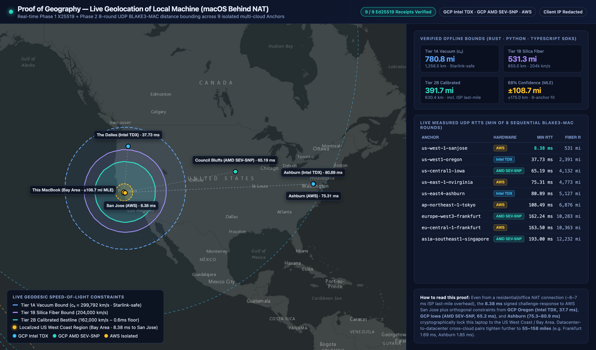
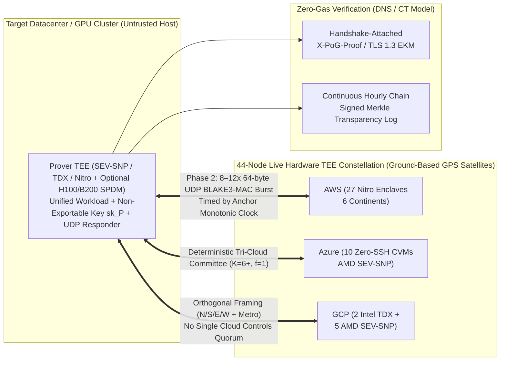

# Proof of Geography (PoG)

[](LICENSE)

**Ground-based GPS for datacenters, GPUs, and AI inference—an unspoofable, cryptographic, speed-of-light location protocol powered by a live 44-node Tri-Cloud Hardware TEE Constellation.**

Like GPS satellites in orbit, **Proof of Geography Anchors** form a global **Constellation** of known-position reference stations across **AWS, Azure, and GCP**—except instead of trusting a self-reported GPS signal, surrounding hardware Trusted Execution Environments (TEEs) bounce microsecond cryptographic challenges off a server's enclave silicon and turn round-trip light travel time into an unforgeable speed-of-light outer bound.

> 🌐 **Live Speed-of-Light Constellation Visualizer:** **[https://proofofgeography.com](https://proofofgeography.com)**
> Ping our live **100% Hardware TEE Constellation** from your browser, test speed-of-light spoof detection, verify live `X-PoG-Proof` bundles online, and inspect the **72-Node Rim-Surrounded** target topology.
>
> 🤖 **Live Verified LLM in Paris (Intel TDX + Tri-Cloud PoG Quorum):** **[https://llm.proofofgeography.com](https://llm.proofofgeography.com)**
> Query a real confidential LLM running inside Google Cloud Confidential Space (`europe-west9` Paris) that cryptographically binds every response to its enclave TLS 1.3 channel, pinned container digest, and live hardware speed-of-light receipts from **all 3 clouds (AWS Nitro + Azure CVM + GCP HW TEE)**.
>
> **Note on Opt-In & Datacenter Precision:** Proof of Geography is 100% **opt-in active sensing** designed for **high-speed datacenters and GPU clusters** (1–2 ms fiber RTT → 46–65 mi). Testing from home Wi-Fi or mobile 4G/5G incurs 10–60+ ms of last-mile radio/ISP overhead and is naturally far less precise.

---

## Try It Right Now (100% Hardware TEE Tri-Cloud Constellation)

### 1. Verify a Live Confidential LLM's Physical Location in One Command
Verify **[https://llm.proofofgeography.com](https://llm.proofofgeography.com)** end-to-end: Intel TDX Confidential Space attestation + pinned zero-shell container digest + RFC 8446 TLS 1.3 EKM channel binding + live tri-cloud speed-of-light hardware quorum (**AWS Nitro + Azure CVM + GCP HW TEE**):

```bash
git clone https://github.com/jperla/proof-of-geography
cd proof-of-geography
cargo run --release --bin pog-cli -- demo-client https://llm.proofofgeography.com \
  --prompt "Where are you physically located?" \
  --grid config/public_anchors.json \
  --expected-image-digest sha256:40f18f8f8cc6358c749203838991252f8eb2b01a7a1518514ed93eb7977e8442 \
  --require-geo-quorum
```

Real live output (`EXIT 0`):
* `inference_tee_verified: true` · `tls_channel_binding_verified: true` · `geographic_proof_verified: true` (`verified_production_hardware_quorum`)
* **`16/16` hardware TEE receipts across all 3 clouds** (`8` AWS Nitro incl. Paris `2.58 ms` + `5` Azure CVM + `3` GCP HW TEE)
* Paris $f=1$ Byzantine bounds: **Calibrated 322.9 km** · **Fiber 799.2 km** · **Vacuum $c_0$ 1,420.6 km**

### 2. Probe Your Machine Against the Live 44-Node Hardware Constellation
1. **In your browser (zero install):** Open **[https://proofofgeography.com](https://proofofgeography.com)** and click **⚡ Locate Me Live** (or **🕵️ Try to Spoof** / **🔐 Verify**).
2. **From your terminal (full cryptographic UDP `BLAKE3-MAC` + Ed25519 receipts):**
   ```bash
   cargo run --release --bin pog-cli -- probe-live \
     --grid config/public_anchors.json \
     --rounds 12 --allow-dev-tee
   ```
3. **Audit the live 44-Node Hardware Constellation (fail-closed against pinned operator root key):**
   ```bash
   cargo run --release --bin pog-cli -- network audit-live \
     --registry config/signed_public_network.json \
     --pinned-root-pk fdff6d6d0b8364e459ffbb921430e39411bd812ec3ce766c2904b39bfa996ee1
   ```
   *(The signed Constellation manifest is served live at `https://proofofgeography.com/.well-known/pog-network.json` and `https://proofofgeography.com/.well-known/pog-registry`.)*

---

## Live 44-Node Tri-Cloud Hardware TEE Constellation (`v0.1.9`)

Every single Anchor in the public Constellation (`config/public_anchors.json` & `config/signed_public_network.json`) is a **real, vendor-root-verified Hardware TEE** (**44/44 Hardware TEE**, **0 `SoftwareDev`**, **0 Ubuntu**):

| Cloud Provider | Live HW TEE Anchors | Hardware Silicon & Enclave Runtime | Offline Vendor-Root Verification |
| :--- | :---: | :--- | :--- |
| **AWS** | **27** | Non-debug ARM64 **AWS Nitro Enclaves** (`c6g.large`, AL2023 kernel 6.12 + `FROM scratch` EIF `v0.1.9`, IMDS disabled) | **27/27 PASS** — AWS Nitro Root-G1 COSE_Sign1 + pinned `PCR0`/`PCR1`/`PCR2` |
| **Azure** | **10** | Zero-SSH immutable **Azure Confidential VMs** (`Standard_DC2as_v6` / `v5` AMD SEV-SNP, TCP `:7443` + UDP + HTTP `:7445`) | **10/10 PASS** — AMD SEV-SNP `VCEK → ASK → ARK` pinned silicon root |
| **GCP** | **7** | **2 Intel TDX** (`c3-standard-4`, Ashburn & Oregon) + **5 AMD SEV-SNP** (`n2d-standard-2` Milan, Iowa / London / Frankfurt / Amsterdam / Singapore; Rocky Linux 9 SELinux Enforcing) | **7/7 PASS** — Intel SGX Root CA (`2/2`) + AMD KDS `VCEK → ASK → ARK-Milan` (`5/5`) |
| **Total Constellation** | **44** | **6 continents · 3 independent clouds · 34 direct-HTTPS browser-pingable + 10 zero-SSH UDP/TCP Azure CVMs** | **44/44 PASS (100% Hardware TEE)** |

### Public Security Lockdown & Federated Constellation PKI
* **Zero Public SSH (`22/tcp` closed everywhere):** All AWS Security Groups, GCP firewalls, and Azure CVM NSGs block port 22; Anchors close HTTP `80/tcp`.
* **Zero Cloud Credentials / IMDS Attack Surface:** AWS EC2 IMDS is completely disabled (`http_endpoint = "disabled"` on `27/27`); GCP VMs have zero IAM service account scopes + Shielded VM Secure Boot, vTPM, and Integrity Monitoring; host `iptables` + cloud egress firewalls block RFC1918 private ranges and all Anchor outbound TCP (UDP `123` NTP + `1024-65535` PoG replies only).
* **Hardened Static `musl` `pog-anchor` (`v0.1.9`) + Enclave Isolation:** Zero-glibc static binary, pinned Google Confidential Space JWKS offline, bounded 32 KiB Phase 1 line cap & 4s/12s Slowloris timeouts, mandatory authenticated UDP `PUNCH` (eliminates UDP reflection DDoS), scoped UDP port window (`40000-40999/udp`), concurrency cap (`64`), per-IP (`12/min`) + global (`600/min`) rate limiting, and strict systemd/enclave confinement.
* **Operator Root-Key Federation & Observed External IPs:** The operator's Ed25519 root private key stays strictly local/offline and signs `https://proofofgeography.com/.well-known/pog-network.json` + per-Anchor `AnchorEndorsement` certs (pinned root public key: `fdff6d6d0b8364e459ffbb921430e39411bd812ec3ce766c2904b39bfa996ee1`). Every Anchor signs its observed `prover_observed_ip` view (`distinct_observed_ips`, `ip_view_consistent`) to flag Anycast / split-egress routing, and relying parties can require quorum across `X` independent operator Constellations (e.g., `proofofgeography.com` + Cloudflare + OVH) in the Rust, TypeScript, Python, and Go SDKs. See [docs/FEDERATION.md](docs/FEDERATION.md).

---

## Why This Matters Right Now

Today, knowing *where* a server or GPU physically sits is built almost entirely on **honor-system paperwork**—cloud region labels, WHOIS entries, ISP geofeeds, and marketing claims. That breaks down across three urgent real-world problems:

1. **Localizing GPUs & National Security / Compute Governance:**
   Governments, hardware vendors, and AI labs increasingly need verifiable assurance of *where* restricted, frontier-class GPUs (H100/B200 clusters) are physically operating—without relying on easily spoofed IP addresses, GPS feeds, or self-reported datacenter claims.
2. **Data Sovereignty & Regulatory Compliance:**
   Enterprises processing healthcare, financial, defense, or GDPR-regulated data must prove workloads execute inside authorized jurisdictions—not merely that a front-end load balancer sits there.
3. **Exposing Inference Cloud & Router Lies:**
   A growing wave of AI inference clouds and multi-provider routers claim US or EU hosting while silently forwarding prompts to cheaper, unapproved, or offshore GPU clusters behind a local reverse proxy. Traditional IP geolocation (even active-probing networks like IPinfo ProbeNet) only locates the *front-end IP endpoint*—a \$5/mo proxy in Singapore or Frankfurt answers ICMP/TCP pings in 1 ms while forwarding the actual LLM inference 4,500 km away.

**Proof of Geography closes this gap with physics and silicon.** By placing a non-exportable signing key inside the Prover's hardware **Trusted Execution Environment** (AMD SEV-SNP, Intel TDX, AWS Nitro Enclaves, optionally bound via SPDM to Confidential GPUs) and having **independent surrounding multi-cloud Constellation Anchors** time unpredictable microsecond UDP challenge-response bursts, a front-end proxy *cannot* answer on the enclave's behalf. Physics forces every challenge packet all the way to the actual CPU/GPU silicon and back, turning round-trip latency into an unforgeable speed-of-light distance disk.



*Datacenter-to-datacenter cross-cloud pairs tighten dramatically with zero last-mile ISP overhead: live **GCP Frankfurt (AMD SEV-SNP) <-> AWS Frankfurt (Nitro)** measured **1.54–1.69 ms** (**46–55 mi** calibrated / **144–158 mi** hard vacuum), and **GCP Ashburn (Intel TDX) <-> AWS Ashburn (Nitro)** measured **1.85 ms** (**65.3 mi** calibrated / **174.7 mi** hard vacuum). See [docs/LIVE_PILOT_RESULTS.md](docs/LIVE_PILOT_RESULTS.md).*

---

## How It Works (The Ground-Based GPS Analogy)



### Core Design Pillars

* **Split Stopwatch from Identity:** The Prover TEE *never* times its own RTT (defending against host hypervisor clock skew/VM freezing). Independent multi-cloud Constellation Anchors hold the stopwatch using monotonic enclave clocks / Linux `SO_TIMESTAMPNS` + `SO_BUSY_POLL` (and AMD Secure TSC), while the Prover TEE provides an unforgeable, migration-disabled (`MIGRATE_MA=0`) hardware-bound cryptographic reply.
* **Two-Tier Physics Bounds + Starlink Defense:** Every proof publishes all three tiers simultaneously (full same-clock RTT, Sagnac, one-way, and satellite assumptions documented in [docs/PHYSICAL_BOUNDS_MODEL.md](docs/PHYSICAL_BOUNDS_MODEL.md)):
  * **Tier 1A — Vacuum Speed of Light (`c_0 = 299,792.458 km/s`, ~93.1 mi/ms RTT):** Strictly uncheatable even against private hollow-core fiber, line-of-sight microwave, or **Starlink LEO vacuum optical inter-satellite links (ISLs)**. *(Our simulation proves Starlink vacuum lasers can beat ideal silica fiber past ~4,283 km, which is why Tier 1A vacuum is the gold-standard adversarial bound.)*
  * **Tier 1B — Silica Optical Fiber (`c_fiber = 204,000 km/s`, ~63.4 mi/ms RTT):** Tighter terrestrial/subsea fiber bound (including cloud private backbones).
  * **Tier 2 — IPinfo-Style Calibrated Empirical Radius:** Learned live from the all-pairs Anchor calibration mesh and fused with RFC 8805 geofeed validation & traceroute rDNS airport-code hints to catch `LastHopProxyJump` router lies.
* **Exact $O(K^3)$ Byzantine $(K-f)$-Core Geometry on $\mathbb{S}^2$:** Upper-bound disks (never thin rings, so artificial delay only *weakens* a proof) are intersected as 3D spherical half-spaces. Even if up to $f$ Anchors collude and fabricate `0.3 ms` RTTs, verifying all at most $K^2 + 1 = 37$ boundary extrema mathematically proves 100% of the feasible region lies inside the geofence.
* **Continuous Hourly Chains + Handshake Proofs (Anti-Boat / Anti-Plane / Mobile DC):** Never attest once—hardware can be attested in port and moved onto a ship, truck, or aircraft. Provers attach fresh `X-PoG-Proof` bundles to connection handshakes **and** append continuous hourly hash-chained proofs to a DNS / Certificate Transparency–style signed Merkle log (`pog-log`). Stationary datacenters tighten their proven radius by **>50%** over 24h via orthogonal minimum-RTT convergence, while any physical relocation triggers an immediate `PhysicalRelocationDetected` alert.
* **Runs Free Like DNS (Blockchain Tabled):** No tokens, wallets, or per-proof gas fees are required. A global hardware Constellation runs as an ultra-cheap public utility, with optional Merkle-root anchoring documented in [docs/BLOCKCHAIN_EXTENSION.md](docs/BLOCKCHAIN_EXTENSION.md).
* **Export-Control, Anti-Smuggling & Privacy Extensions (Brass & Aarne 2024; Tee & Happel 2026):**
  * **Verifier-Enforced Target/Radius & `ChipRegistry`:** Overrides untrusted Prover self-claimed coordinates/radii and binds `prover_pk` / `gpu_uuid` to authorized facilities.
  * **Negative Geofencing & "Striking Distance" Jurisdiction Filters:** Proves 0% overlap with restricted polygons (`CN`, `RU`, `KALININGRAD`, custom GeoJSON) and 100% containment inside allowed jurisdictions (`US-CONUS`, `EU-CORE`, `JP`), while excluding Anchors in sensitive jurisdictions (`--exclude-anchor-country HK`) across our 25-country live Constellation.
  * **Silence, Delay-Inflation, Fast-Path & Rack-Divergence Telemetry:** Flags silent/blocked Provers (`/v1/anomalies/silent`), subtle baseline RTT shifts (`BaselineLatencyShiftDetected`), universal delay inflation (`UniversalDelayInflationSuspected`), hollow-core/dark-fiber shortcuts (`ExceedsSilicaFiberSpeed`), and smuggled rack members (`/v1/clusters`).
  * **GPU Silicon PUF Extension with Relay-Headroom Physics Guard:** Supports seeded GPU PUF re-identification (`pog-tee::verify_gpu_physical_fingerprint`) while explicitly surfacing why a `2.9 s` SM `atomicAdd` PUF kernel with 1% jitter (`29 ms`) allows `~4,347 km` of vacuum relay headroom and therefore complements—never replaces—sub-ms UDP distance bounding.
  * **Privacy-Preserving Coarse Jurisdiction Leases (`X-PoG-Lease`):** Issue and verify compact signed operating licenses (`pog-cli lease issue|verify`) proving jurisdiction compliance and enforcing on-chip monotonic countdown timers (`max_monotonic_lease_seconds`) with **zero** raw RTTs, IPs, or exact city coordinates revealed.

---

## Split-TEE Attacks Against LLMs: What Is Blocked vs. What Remains Possible

A **split-TEE attack** tries to pass speed-of-light location proofs on a legitimate hardware TEE in an approved city (e.g., Paris or Frankfurt) while executing the actual LLM inference on a *different* machine or GPU elsewhere. Whether a split-TEE attack works depends sharply on the deployment architecture and what the client verifier checks:

| Split-TEE Vector | Possible Today? | Mechanism | Enforcement & Residual Gap in `proof-of-geography` |
| :--- | :---: | :--- | :--- |
| **1. Decoy PoG TEE + Remote LLM (Proxy Mode)** | **Yes** *(in proxy mode)* / **Blocked** *(in measured local runtime)* | Run `pog-prover --upstream` in Frankfurt to emit valid `X-PoG-Proof` headers while forwarding prompts to an offshore LLM, or splice TEE #1's location bundle onto TEE #2's LLM response. | Proxy mode explicitly declares `X-PoG-Claim-Mode: prover-only-geography` and fails closed on inference-location verification (`verify_prover_only_header_cannot_prove_inference`). In measured local mode (`pog-llm-demo` / `--local-gpu-runtime`), TLS 1.3, local inference, and out-of-band PoG share **one** in-RAM non-exportable `prover_pk` (`pog_proof_bundle.prover_quote.public_key_hex == receipt.prover_pk_hex == hardware_quote.public_key_hex` + signed `pog_bundle_hash_hex`). |
| **2. Rogue-Image Split-TEE (Unpinned Container Digest)** | **Yes — if client skips digest pinning** | Build a *malicious* TEE image in Paris that answers PoG UDP bursts locally, terminates TLS 1.3 locally, silently forwards prompts over HTTPS to an offshore GPU, and signs receipts claiming `remote_upstream_disabled: true`. | Self-reported receipt flags are **not** trusted on their own. Verifiers **must** pin `allowed_container_digests` / `allowed_inference_runtime_measurements` to a reproducible, source-audited zero-shell `FROM scratch` image (with `cmd_override == []` and `dbgstat == disabled-since-boot`) so the running enclave literally contains no upstream HTTP client or fallback code. |
| **3. Front-End TLS MITM / Stock-SDK Split** | **Yes — for stock OpenAI SDK / browser `fetch()`** | Place a TLS-terminating reverse proxy in front of an honest LLM TEE (or swap receipts across requests) when the client cannot inspect the TLS handshake. | `pog-llm-demo` and `pog-prover --local-gpu-runtime` terminate TLS 1.3 inside the enclave (`rustls`) and bind every receipt to RFC 8446 §7.5 Exported Keying Material (`EXPORTER-pog-inference-v1`), `server_cert_sha256_hex` signed by `prover_pk`, `tls_connection_request_seq`, caller `X-PoG-Client-Nonce`, and blinded SHA-256 request/output commitments (`X-PoG-Commitment-Salt`). Closing this vector requires an EKM-aware client (`pog-cli demo-client` / `verify_cpu_inference_evidence` / `sdks/python/pog_openai_verifier.py`), not a stock browser/SDK alone. |
| **4. Split CPU-TEE ↔ Confidential GPU (SPDM Tunneling)** | **Uncoupled quotes: Blocked** · **SPDM-over-fiber relay: Residual risk** | Put a PoG-located CPU TEE in City A and either (a) attach an uncoupled valid GPU quote from City B, or (b) tunnel PCIe/SPDM 1.2 bounce-buffer frames over fiber/fabric to a real NVIDIA CC H100/B200 in City B. | **(a) Blocked:** `verify_gpu_attestation_evidence()` requires mutual coupling (`gpu_nonce = SHA256("pog-gpu-bind-v1" \|\| prover_pk \|\| epoch_challenge \|\| spdm_transcript_hash)` + CPU `report_data` commitment). **(b) Residual risk on standard SPDM 1.2 GPUs:** SPDM proves an encrypted channel, **not** physical cable length, and current CC GPUs do not natively sign per-request `(request_hash, output_hash)` in GPU silicon. Verifiers explicitly surface `hardware_locality_established: false` (`SpdmProtectedLocalChannelAssumedColocated`) + `locality_assumptions`, and offer `require_hardware_rooted_locality: true` for PCIe 6.0 IDE / NVLink-C2C topology proofs or sub-10 µs CPU↔GPU distance-bounding. **Monolithic CPU-only TEEs** (`pog-llm-demo` on Intel TDX Confidential Space) eliminate the CPU↔GPU split entirely because weights, inference, TLS 1.3, and PoG execute on one CPU die. |
| **5. Multi-Node Distributed LLM Split (TP/PP/RAG) & Inter-Refresh Window** | **Yes — unless every worker is bound** | For large multi-node models (tensor/pipeline parallel, prefill/decode disaggregation, or external RAG/tool calls), prove PoG only on the ingress/coordinator TEE while shipping activations, KV-cache, or prompts to unlocated worker TEEs. | Single-node measured images forbid worker egress (`remote_upstream_disabled = true`). Multi-node confidential LLMs must bind every worker TEE's own verified `GeoProofBundle` into the inference receipt (or have the measured coordinator sub-ms distance-bound its workers before releasing activations). Between out-of-band PoG refreshes (e.g. every 10 min), hardware `MIGRATE_MA=0` / `MIGRATABLE=0` blocks live VM migration of volatile `sk_P` across hosts. |

> **Bottom line for LLM deployments:**
> * **Monolithic CPU-only Confidential Space LLM (`https://llm.proofofgeography.com`):** Split-TEE attacks are **blocked** whenever the verifying client pins the audited zero-shell container `image_digest` **and** verifies end-to-end TLS 1.3 EKM (`EXPORTER-pog-inference-v1`) + the hardware PoG quorum (note: GCP Confidential Space OIDC JWT verification still places Google's attestation signing service in the TCB unless raw Intel TDX DCAP quotes are verified directly).
> * **Confidential-GPU LLM (H100/B200 CC):** Uncoupled CPU/GPU split-TEEs and proxy relays are **blocked**, while **physical PCIe/SPDM tunneling across distance** remains an explicitly surfaced assumption (`hardware_locality_established: false`) until hardware-rooted PCIe-IDE topology attestation or microsecond CPU↔GPU distance-bounding is enforced. See [docs/THREAT_MODEL.md](docs/THREAT_MODEL.md) and [docs/VERIFIED_PRODUCTION_TRUST_MODEL.md](docs/VERIFIED_PRODUCTION_TRUST_MODEL.md).

---

## How Many Trillions of Requests Can the Constellation Handle?

Empirical release-build benchmarks (`cargo run --release --bin pog-cli -- bench`) + full breakdown in [docs/CAPACITY_AND_ECONOMICS.md](docs/CAPACITY_AND_ECONOMICS.md):

* **Prover Timed Fast-Path (`BLAKE3-MAC`):** **72.7 ns/op** (**13.76M ops/sec/core**) — adds `< 0.0001 ms` (`< 15 meters`) to the speed-of-light radius.
* **Client Offline Verification (`verify_proof_bundle` — TEE quote + 6 Ed25519 sigs + exact $O(K^3)$ Byzantine core):** **131.5 µs/verify** (**7,606 verifies/sec/core**).
* **Raw Live UDP Proofs (24–44 Anchors, 1 pinned NIC core/node @ 120k pkt/s, $M=8$ rounds, $K=6$ Anchors/proof):**
  * **~60,000–110,000 raw live proofs/sec** = **~1.9–3.5 TRILLION raw live proofs / year**.
* **Handshake-Attached / Hourly-Cached Client Requests (DNS-style):**
  * Once a datacenter/GPU cluster refreshes its signed proof hourly (or every 5 minutes), it attaches the compact `X-PoG-Proof` header to **every** incoming TLS/API/inference connection with **zero traffic to the Constellation**.
  * **10,000,000 distinct servers globally** running continuous hourly chains consume **< 5% of the Constellation**, while authenticating **tens of trillions to quadrillions of client requests per year**.

---

## Live Red-Team & Physics Simulation Results

Run locally via `cargo run --release --bin pog-cli -- simulate`:

| Scenario | Result | Key Measurement |
| :--- | :--- | :--- |
| **1. Honest Tokyo H100 GPU Cluster** *(4 clouds, $f=1$ Byzantine quorum)* | **PASS** | Tier 1A Vacuum: **161.7 km (100.5 mi)** · Tier 1B Fiber: **111.3 km (69.2 mi)** · Tier 2 Calibrated: **90.8 km (56.4 mi)** |
| **2. Inference Router Lie** *(Beijing GPUs proxying via Singapore)* | **CAUGHT** | Front-end IP responds in `1.4 ms` in Singapore, but TEE RTT = `62.0 ms` -> worst-case distance **6,828 km** + 3 IPinfo proxy/geofeed alerts |
| **3. Starlink LEO Laser Relay Audit** *(550 km shell, 40° elev)* | **AUDITED** | Beats ideal fiber past **4,283 km**, failing Tier 1B at 5,000–9,000 km; **Tier 1A Vacuum remains 100% SAFE at all distances** |
| **4. Byzantine Colluding Anchor** *(1 of 6 fabricates `0.3 ms` RTT)* | **BLOCKED** | 5-of-6 Byzantine core rejects Singapore spoof (max distance **6,713 km**) |
| **5. Mobile Datacenter / Relocation** *(Ashburn -> Frankfurt in 8h)* | **CAUGHT** | Disjoint feasible regions trigger `PhysicalRelocationDetected` (**6,544 km**, implied speed **818 km/h**) |
| **6. 24-Hour Stationary Convergence** *(Chicago — no local anchor!)* | **CONVERGED** | 4-direction orthogonal hourly chain cuts Tier 1B radius from `1,785 km` -> **835 km (53.2% tighter)** |
| **7. Anti-Smuggling Geofence, Country Filter & Coarse Lease** *(Tokyo vs Shanghai, `HK`/`CN`/`RU` Anchors excluded)* | **ENFORCED** | Honest Tokyo passes `CN` exclusion + mints privacy-preserving `X-PoG-Lease` (on-chip monotonic timer locks on expiry); smuggled Shanghai chip claiming self-target + `5,000 km` is **CAUGHT** by `ChipRegistry` + `CN` polygon |
| **8. GPU Silicon PUF Relay-Headroom Audit + Cluster Rack-Divergence & Silence** | **AUDITED** | Paired PUF re-identifies H100 silicon (`L1=22.0`), flags `29 ms = 4,347 km` vacuum relay headroom (`bounds_physical_relay_alone=false`); `ContinuousGeoLog` catches smuggled rack member & silent provers |

---

## 72-Node Rim-Surrounded Global Target Topology (vs. 24-Node Starter)

Coastal and border cities (e.g., Lisbon, Dublin, Helsinki, Istanbul, San Francisco, Miami, Vancouver, Mexico City) suffer severe **GDOP** (Geometric Dilution of Precision—the exact same geometry effect as GPS satellites!) if nearby Anchors sit inland on only one side. Our canonical **[72-Node Rim-Surrounded Topology](config/global_grid_72.json)** ([docs/GRID_72_TOPOLOGY.md](docs/GRID_72_TOPOLOGY.md) · [infra/terraform/grid_72](infra/terraform/grid_72/main.tf)) surrounds both **North America** and **Europe** from all four compass quadrants (`N / S / E / W`):

| Global Theater | Nodes | Core Multi-Cloud Hubs | Outer Rim Perimeter Anchors (Kills Coastal & Border GDOP) |
| :--- | :---: | :--- | :--- |
| **North America + Canada + Mexico + Caribbean** | **26** | Ashburn (×2), NYC/Newark, Columbus, Chicago, Iowa, Dallas, Salt Lake City, Phoenix, LA, San Jose, Oregon (×2), Toronto, Montreal (×2) | **Honolulu (`HI`)**, **Anchorage (`AK`)**, **Vancouver**, **Calgary**, **Halifax (`NS`)**, **Miami**, **Querétaro / Mexico City** (GCP + AWS), **San Juan (`PR`)**, **Panama City** |
| **Europe + North Atlantic + North Africa + Middle East + East Rim** | **30** | London (×2), Frankfurt (×2), Paris, Amsterdam, Zurich, Dublin, Madrid, Milan, Marseille | **Reykjavík (Iceland)**, **Tórshavn (Faroe Islands)**, **Ponta Delgada (Azores)**, **Lisbon**, **Oslo**, **Stockholm**, **Hamina (Finland)**, **Casablanca (Morocco)**, **Cairo (Egypt)**, **Tel Aviv**, **Athens**, **Warsaw (×2)**, **Bucharest**, **Istanbul**, **Dubai**, **Doha**, **Almaty**, optional Moscow IXP |
| **Asia-Pacific, Oceania, LatAm & Africa** | **16** | Tokyo (×2), Seoul, Taiwan, Hong Kong, Singapore (×2), Mumbai (×2), Jakarta, Sydney, São Paulo, Santiago, Johannesburg | **Auckland (`NZ`)**, **Cape Town (`ZA`)** |

**Verified Rust GDOP Audit (`pog-cli audit-coverage --grid config/global_grid_72.json --baseline-grid config/global_grid_24.json`, $f=1$ Byzantine):**
* **7.05× tighter border & coastal localization:** 20-city mean calibrated bound drops from **`1,341 mi` → `190 mi`**, jumping from **1/20 → 19/20** cities with full **4/4 compass-quadrant surround** (e.g., Lisbon `2,043 → 211 mi`, Miami `1,918 → 186 mi`, San Francisco `1,039 → 159 mi`, Istanbul `2,392 → 135 mi`, Helsinki `1,176 → 292 mi`, Mexico City `3,034 → 240 mi`, Warsaw `806 → 11 mi`).
* **Live 44-Node Hardware Constellation** is in [config/public_anchors.json](config/public_anchors.json) / [config/signed_public_network.json](config/signed_public_network.json); the **starter 24-node config** remains in [config/global_grid_24.json](config/global_grid_24.json).

---

## Repository Layout

* `crates/pog-geo` — Exact $\mathbb{S}^2$ spherical cap math, Tier 1A/1B/2 + Starlink ISL bounds, $O(K^3)$ Byzantine $(K-f)$-core verifier, all-pairs Anchor calibration matrix, and continuous-chain mobile-datacenter relocation detector.
* `crates/pog-tee` — Hardware TEE providers & fail-closed offline silicon verification (`MIGRATE_MA=0`, `DEBUG=0`, `SecureTSC`, Confidential GPU SPDM binding) for AMD SEV-SNP (pinned AMD ARK), Intel TDX (pinned Intel SGX Root CA), AWS Nitro Enclaves (pinned AWS Nitro Root-G1 COSE_Sign1 + PCR0/1/2), GCP Confidential Space (pinned Google JWKS), and Azure CVM HCL+vTPM.
* `crates/pog-proto` — Deterministic multi-cloud/multi-quadrant committee selection, fixed 64-byte UDP `BLAKE3-MAC` wire protocol, Linux `SO_TIMESTAMPNS` / `SO_BUSY_POLL` socket fast-path, `X-PoG-Proof` handshake header encoding, and standalone offline verifier.
* `crates/pog-telemetry` — IPinfo-inspired active telemetry fusion (RFC 8805 geofeed parser, traceroute IATA airport-code rDNS extractor, `LastHopProxyJump` detector, 68%/95% confidence radii).
* `crates/pog-log` — DNS / Certificate Transparency–style append-only signed Merkle log (`RFC 6962` inclusion proofs + `SignedTreeHead`) with Axum HTTP API (`/.well-known/pog-registry`, `/.well-known/pog-network.json`, `/v1/attestations`, `/v1/provers/:id/latest`, `/v1/sth`, `/v1/verify-header`).
* `crates/pog-anchor` — Production multi-cloud Constellation Anchor TEE daemon (TCP Phase 1 + pinned UDP Phase 2 + AWS Nitro vsock enclave relay + `/attest?nonce=`).
* `crates/pog-prover` — Production Prover TEE sidecar (hourly hash-chain runner, automatic `--log-url` transparency log submission, `/v1/handshake-proof`, and `--upstream` / `--local-gpu-runtime` HTTP server injecting `X-PoG-Proof`).
* `crates/pog-llm-demo` — Monolithic Confidential Space Verified LLM demo (`https://llm.proofofgeography.com`) binding local CPU inference + TLS 1.3 EKM + pinned container digest + live tri-cloud hardware PoG quorum.
* `crates/pog-cli` — Verifier, Verified LLM `demo-client`, Constellation `network audit-live` / `verify-attest` / `sign-registry`, red-team simulator, throughput benchmarker, live multi-cloud prober (`probe-live`), calibration mesh auditor (`calibrate-mesh`), transparency log server (`serve-log`), and GeoJSON exporter.
* `web/` — Live interactive speed-of-light Constellation visualizer deployed at **[https://proofofgeography.com](https://proofofgeography.com)**.
* `infra/terraform`, `infra/images` & `infra/reproducible` — Multi-cloud IaC modules (27 AWS Nitro regions, GCP TDX/SEV-SNP, Azure CVM, 72-node topology), reproducible measured NixOS TEE VM `flake.nix`, deterministic SHA-256 Docker/host measurement builder, and AWS Nitro ARM64 `.eif` pipeline.

---

## Client Verifier SDKs (Zero External Dependencies)

Inference clients, API gateways, and compliance auditors can verify `X-PoG-Proof` handshake headers offline in **Rust, TypeScript, Python, or Go** with zero third-party packages:

* **TypeScript / Node 20+** ([sdks/typescript](sdks/typescript/src/index.ts)): uses native `node:crypto` (`sha256` + `ed25519`)
  ```ts
  import { verifyProof } from "./sdks/typescript/src/index.ts";
  const report = verifyProof(res.headers.get("X-PoG-Proof")!, constellation);
  if (!report.overallValid) throw new Error(report.failureReasons.join("; "));
  ```
* **Python 3.10+** ([sdks/python](sdks/python/pog_verifier/verifier.py)): pure-Python RFC 8032 Ed25519 fallback (auto-accelerates if `cryptography` is installed) + OpenAI-compatible TLS 1.3 EKM Verified LLM client ([pog_openai_verifier.py](sdks/python/pog_openai_verifier.py))
  ```python
  from pog_verifier import verify_proof
  report = verify_proof(response.headers["X-PoG-Proof"], constellation)
  assert report.overall_valid
  ```
* **Go 1.22+** ([sdks/go](sdks/go/verifier.go)): 100% Go standard library (`crypto/ed25519`, `crypto/sha256`)

---

## Precision: Getting Down to 25–150 Miles

| Location Type | Tier 1A Hard Vacuum ($f=1$, Starlink-safe) | Tier 1B Hard Fiber ($f=1$) | Tier 2 Calibrated Linear Bestline | IPinfo-Style 68% Confidence (MLE) |
| :--- | :---: | :---: | :---: | :---: |
| **Major Metro Hubs** *(Tokyo, Ashburn, Frankfurt, Singapore, Oregon, London, Paris — 2+ local cross-cloud Anchors)* | **~100–250 mi** (162–400 km) | **~69–150 mi** (111–240 km) | **~26–55 mi** (41–90 km) | **~45 mi** (75 km) |
| **Non-Hub Cities on 24-Node Grid** *(e.g. Chicago — nearest Anchors 435–595 mi away)* | ~600–850 mi | ~518 mi (24h converged) | ~350–640 mi ($f=1$) / ~150–250 mi ($f=0$) | **~90–150 mi** (150–240 km) |
| **Densified 48–72 Node Regional Constellation** *(~300–450 mi spacing across NA/EU/East Asia)* | ~250–350 mi | ~150–220 mi | **~80–150 mi** | **~35–90 mi** |

---

## Quickstart & Verification

```bash
# 1. Run full Rust + TypeScript + Go + Python + Web test suites
cargo test --workspace
cargo run --release --bin pog-cli -- export-sdk-fixture
(cd sdks/typescript && node --test ./test.ts)
(cd sdks/go && go test -v ./...)
(cd sdks/python && PYTHONPATH=. python3 -m unittest discover -v tests)
node --test web/test_geo.mjs

# 2. Verify the live Paris Confidential Space LLM over tri-cloud hardware quorum
cargo run --release --bin pog-cli -- demo-client https://llm.proofofgeography.com \
  --prompt "Where are you physically located?" \
  --grid config/public_anchors.json \
  --expected-image-digest sha256:40f18f8f8cc6358c749203838991252f8eb2b01a7a1518514ed93eb7977e8442 \
  --require-geo-quorum

# 3. Run the 8-scenario red-team simulation & border-city / anti-smuggling GDOP audits
cargo run --release --bin pog-cli -- simulate
cargo run --release --bin pog-cli -- audit-coverage --grid config/global_grid_72.json --baseline-grid config/global_grid_24.json
cargo run --release --bin pog-cli -- audit-coverage --grid config/public_anchors.json --restricted-polygon CN --exclude-anchor-country HK

# 3b. Enforce negative geofencing, striking-distance Anchor exclusion & issue/verify privacy-preserving X-PoG-Lease
cargo run --release --bin pog-cli -- verify --grid config/public_anchors.json --bundle-json bundle.json \
  --restricted-polygon CN --exclude-anchor-country HK --min-distinct-countries 2 --max-radius-km 600
cargo run --release --bin pog-cli -- lease verify --lease-json lease.json \
  --pinned-issuer-pk fdff6d6d0b8364e459ffbb921430e39411bd812ec3ce766c2904b39bfa996ee1 \
  --require-excluded CN --elapsed-monotonic-seconds 120

# 4. Run the drop-in Prover TEE reverse-proxy sidecar (auto-injects X-PoG-Proof on every API response)
cargo run --release --bin pog-prover -- --grid-path config/public_anchors.json \
  --claimed-lat 37.3382 --claimed-lon=-121.8863 --upstream http://127.0.0.1:8000 --log-url http://127.0.0.1:8090 --allow-dev-tee

# 5. Build & verify reproducible SHA-256 TEE workload measurements from source
./infra/reproducible/build_reproducible.sh
./infra/reproducible/verify_measurement.sh dist/reproducible/measurement_manifest.json dist/reproducible
```

---

## Further Reading

* [docs/FEDERATION.md](docs/FEDERATION.md) — **Multi-Operator Constellation Federation & Local Root-Key PKI:** run your own signed Constellation (Cloudflare, OVH, independent orgs) and verify quorum across `X` independent operators in Rust, TypeScript, Python, and Go.
* [docs/GRID_72_TOPOLOGY.md](docs/GRID_72_TOPOLOGY.md) — **72-node rim-surrounded global Constellation topology** (`config/global_grid_72.json`): 26 NA/Canada/Mexico/Caribbean + 30 Europe/Iceland/Faroe/Azores/North Africa/Middle East/East Rim + 16 APAC/Global South — cuts border-city $f=1$ localization **7.05× tighter** (`1,341 mi → 190 mi` mean, `19/20` full 4/4 quadrant surround!).
* [docs/LIVE_PILOT_RESULTS.md](docs/LIVE_PILOT_RESULTS.md) — **Real live cross-cloud RTT matrix & verified Intel TDX / AMD SEV-SNP proofs** measured over the public internet (Frankfurt 1.69 ms -> 55–158 mi; Ashburn 1.85 ms -> 65–175 mi).
* [docs/DEPLOY_24_NODES.md](docs/DEPLOY_24_NODES.md) — Step-by-step guide to deploying your own Constellation & public web playground.
* [docs/ARCHITECTURE.md](docs/ARCHITECTURE.md) — Protocol sequence, Starlink ISL crossover physics, and exact $O(K^3)$ Byzantine $(K-f)$-core proof.
* [docs/THREAT_MODEL.md](docs/THREAT_MODEL.md) — 11 adversarial attack vectors (including proxies, split-TEEs, Starlink, mobile boats/aircraft, clock skew, and colluding clouds) and residual risks.
* [docs/VERIFIED_PRODUCTION_TRUST_MODEL.md](docs/VERIFIED_PRODUCTION_TRUST_MODEL.md) — Zero-SSH image substantiation, official vs. external Constellations, and host/control-plane trust boundaries.
* [docs/CAPACITY_AND_ECONOMICS.md](docs/CAPACITY_AND_ECONOMICS.md) — Detailed trillions-of-requests throughput math and multi-cloud operating costs.
* [docs/BLOCKCHAIN_EXTENSION.md](docs/BLOCKCHAIN_EXTENSION.md) — Optional future on-chain STH / smart-contract settlement path.

---

## License

Licensed exclusively under the **[Apache License, Version 2.0](LICENSE)** across all Rust crates, TypeScript/Python/Go verifier SDKs, Terraform modules, and documentation.
